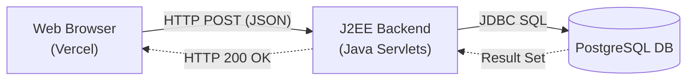

# College Event Feedback System

A polished, single-page feedback form built with HTML/CSS/Vanilla JS and a J2EE (Servlets) backend, connected to a PostgreSQL database.

## Architecture

The system uses a decoupled client-server architecture:



## System Requirements
- **Frontend**: Any modern web browser.
- **Backend**: Java 8+, Apache Maven.
- **Database**: PostgreSQL 12+.

## Database Setup

1. Install and start PostgreSQL.
2. Create a database named `feedback_db` (or whatever you prefer).
3. Run the SQL schema script located at `backend/src/main/resources/schema.sql` against your database.
4. Copy `.env.example` to set your credentials (if deploying) or just set them in your system environment variables `DB_URL`, `DB_USER`, `DB_PASSWORD`. If not set, the app defaults to `localhost:5432/feedback_db` with `postgres/postgres`.

## Running Locally

### 1. Backend (Java Servlets)
1. Open a terminal and navigate to the `backend/` directory.
2. Run the application using the embedded Tomcat plugin:
   ```bash
   mvn tomcat7:run
   ```
   *The server will start on `http://localhost:8081`.*
3. You can verify it's running by opening `http://localhost:8081/api/feedback` in your browser.

### 2. Frontend
Since the frontend uses pure HTML/JS/CSS, no build step is required!
1. Simply open `frontend/index.html` in your web browser.
2. Alternatively, for a better development experience, you can serve the directory using Python or VS Code Live Server:
   ```bash
   cd frontend
   python -m http.server 8000
   ```
   *Then open `http://localhost:8000`.*

## Deployment Instructions

### Vercel (Frontend)
1. Commit the `frontend/` directory and push it to your GitHub repository.
2. Go to [Vercel.com](https://vercel.com) and log in with GitHub.
3. Click **Add New > Project** and import your `J2EE_feedback` repository.
4. **IMPORTANT**: In the deployment settings, change the **Root Directory** from `./` to `frontend`.
5. Click **Deploy**.
6. **Note**: Before pushing to production, open `frontend/app.js` and change `CONFIG.API_URL` to point to your live Java backend URL instead of `localhost:8081`.

### Java Backend Deployment (e.g. AWS, Render, Railway, Tomcat Server)
1. Inside the `backend/` directory, run `mvn clean package`.
2. This will generate a `.war` file in the `backend/target/` directory.
3. Deploy this `.war` file to any Java-compatible platform (like Apache Tomcat, WildFly, or a cloud PaaS that supports Java).
4. Configure the environment variables (`DB_URL`, `DB_USER`, `DB_PASSWORD`) on your host provider to point to your hosted PostgreSQL database.

#### CORS Configuration
#### CORS Configuration
The backend includes a built-in `CorsFilter.java` (implemented via `javax.servlet.Filter`) mapped to `/*`. By default, it allows all origins (`*`) so that your Vercel domain can make API calls without being blocked by the browser. For production, you may want to change `*` to your exact Vercel URL in `CorsFilter.java`.
